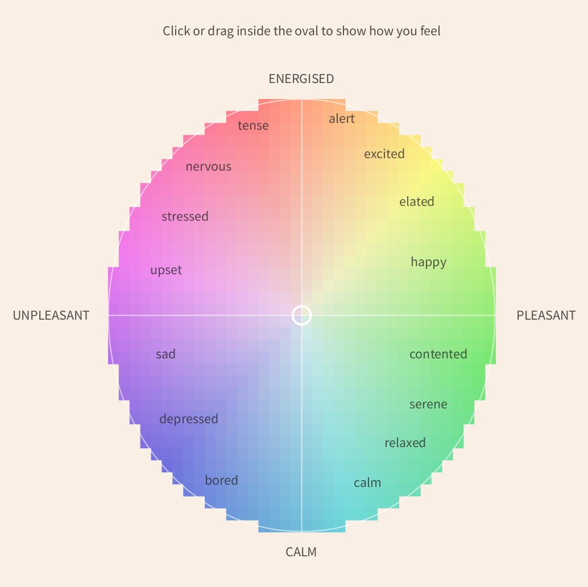
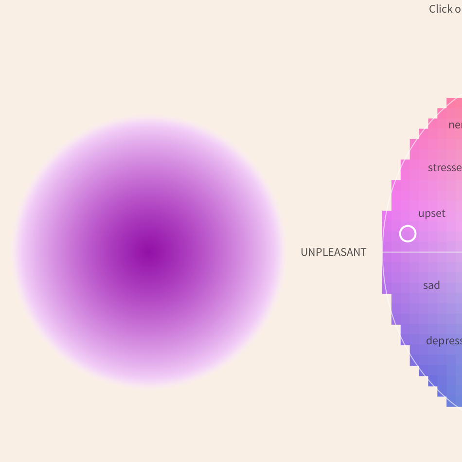

# Aura-Meet-Emotions-Meet-Colour
## Introduction 
Interactive Aura is a creative coding project that explores how emotions can be represented through colour and visual movement. Using the Russell Circumplex Model of Affect, users can select how they are feeling through an interactive emotion map, which translates their emotional state into a corresponding coloured aura. 
## Technologies 
**Langauge:** Python 
**Environment:** Processing (Python Mode) 
**Colour system:** HSB (Hue, Saturation, Brightness)
**Core techniques:** Loops, functions, conditional statement, mouse interaction and animation.
## Features 
Interactive emotion map based on the Russell Circumplex Model. 
Selection of emotional states through mouse clicks or dragging. 
Dynamic colour changes based on valence and arousal. 
Smooth transitions between selected emotional states. 
Animated aura with a layered gradient and pulsing movement. 
Visual presentation of emotions through colour, brightness and saturation. 
## Launch
Download and install Processing. 
Open Processing and select Python Mode. 
Download or duplicate this repository. 
Open the Aura prototype file in Processing. 
Press Run to launch the sketch. 
One running, click or drag inside the emotion map on the right-hand side to select how you are feeling. The aura on the left will gradually change to reflect your selection. 
## Screenshots 
### Interactive Emotion Map 
 
 
## Further Learning Resources
### Processing and Python References
[Processing.py Reference] (https://py.processing.org/reference/) - Reference for Processing functions, including shapes, colour, animation and interaction. 
[Processing.py Interactivity Tutorial] (https://py.processing.org/tutorials/interactivity/) - Understanding mouse interaction and user input. 
[Python - Control Flow] (https://docs.python.org/3/tutorial/controlflow.html) - Understanding loops, functions and conditional statements. 
[Processing - Radial Gradient Example] (https://processing.org/examples/radialgradient) - Inspiration for creating gradients using layered circles. 
### Psychological and Colour References 
[Russell (1980) - A Circumplex Model of Affect] (https://pdodds.w3.uvm.edu/research/papers/others/1980/russell1980a.pdf) - The model informing the interactive emotion map. 
[Posner, Russell & Peterson (2005)] (https://pmc.ncbi.nlm.nih.gov/articles/PMC2367156/) - Further explanation of the Circumplex Model. 
[Psychology of Colour - Visual Reference] (https://www.rodriguezpaintingks.com/blog/colour-psychology-how-different-hues-influence-your-mood) - Visual inspiration and guide for exploring colour associations. 
## Project Status 
Completed prototype developed as part of a creative coding project. The project demonstrates an interactive visual representation of emotional states through colour and animation. 
